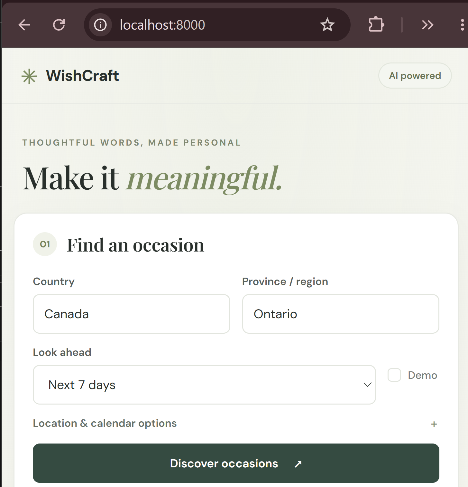
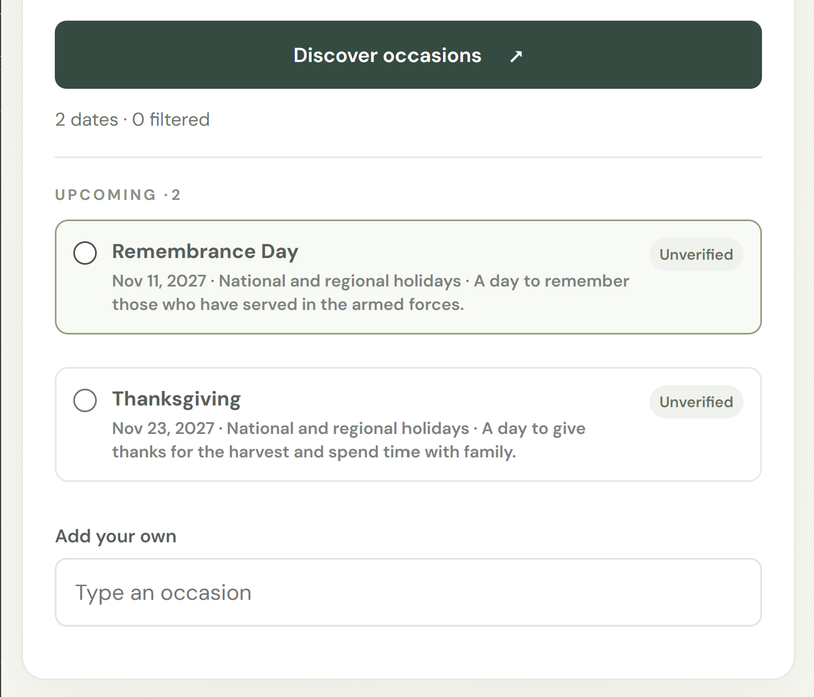
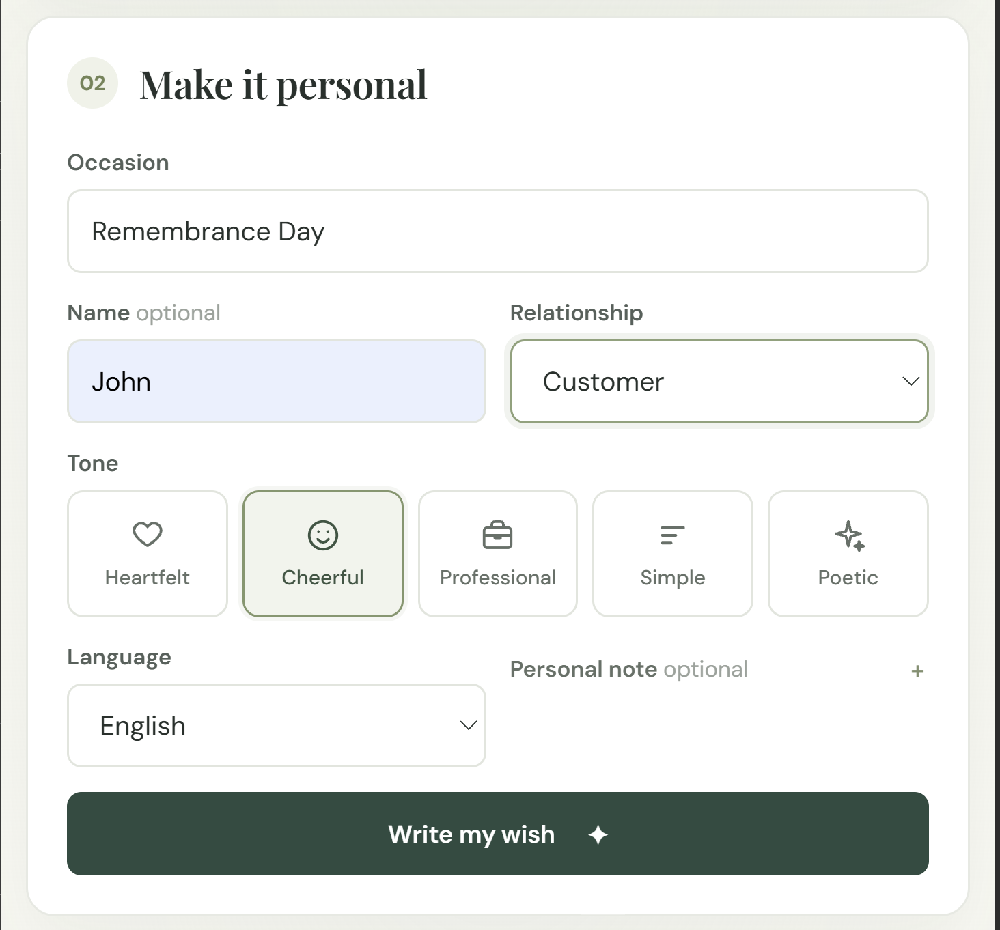
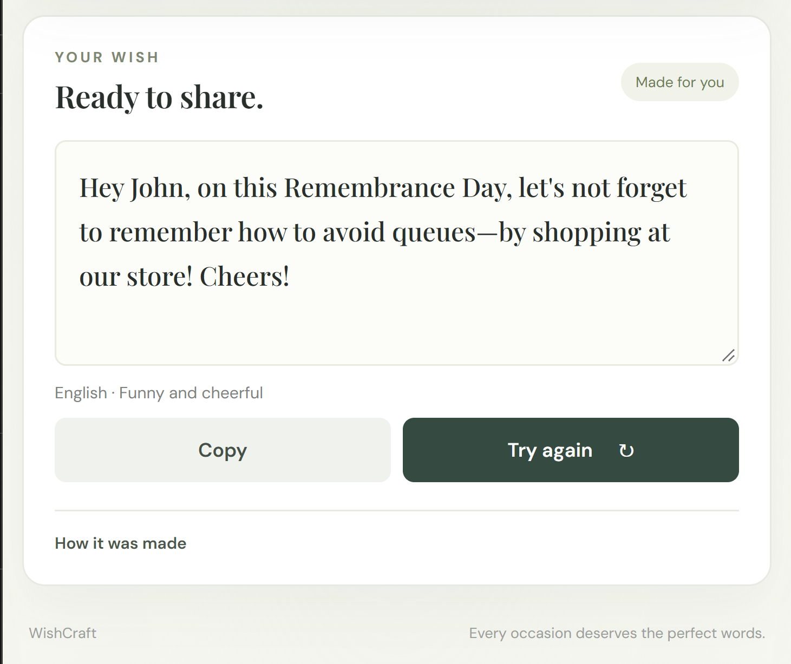

# WishCraft

**Every occasion deserves the perfect words.** WishCraft discovers upcoming occasions for a selected place and date range, then helps write an editable greeting for the person you have in mind.

This is a compact, self-hostable MVP: FastAPI + Pydantic backend, a responsive vanilla TypeScript-free browser UI (plain HTML/CSS/JS to avoid a build step), and a provider adapter for Ollama or an OpenAI-compatible chat completion API. The UI works on phones and desktop. The LLM performs real occasion discovery in normal mode; no holiday dataset or public holiday API is used. Demo mode is explicitly labeled and its sample occasions are kept in the browser only.

## Screenshots

The screenshots below show the occasion discovery form, suggested occasions, personalization options, and an editable generated greeting.

<p align="center"></p>

<p align="center"></p>

<p align="center"></p>

<p align="center"></p>

## Run locally with Docker

1. Install Docker Desktop and copy `.env.example` to `.env`.
2. Run `docker compose up --build`.
3. In another terminal, fetch the default model: `docker compose exec ollama ollama pull qwen2.5:7b`.
4. Open [http://localhost:8000](http://localhost:8000). API docs are at [http://localhost:8000/docs](http://localhost:8000/docs).

The first model download can take several gigabytes. An Ollama model supported by your machine can be selected with `LLM_MODEL`.

## Run without Docker

Use Python 3.11 or newer and install/run the Ollama app separately (or configure another compatible endpoint).

```powershell
cd backend
python -m venv .venv
.\.venv\Scripts\Activate.ps1
pip install -r requirements.txt
Copy-Item ..\.env.example ..\.env
$env:LLM_BASE_URL = "http://localhost:11434"
uvicorn app.main:app --reload
```

The single FastAPI process serves the frontend and `/api/v1` endpoints on port 8000. It loads settings from the workspace `.env` file. Set `LLM_PROVIDER=openai_compatible`, `LLM_BASE_URL`, `LLM_MODEL`, and `LLM_API_KEY` there to use a compatible API instead. The key is never sent to the browser. Do not commit `.env`.

## How it works

1. The browser sends country, region, IANA timezone, inclusive dates and optional calendar preferences.
2. The discovery service builds a date-aware prompt and invokes the configured model. Pydantic validates each occasion and the service drops malformed/out-of-window dates. Variable observances are labeled for verification and confidence is exposed.
3. The user chooses an occasion (or types a custom one), sets recipient, relationship, tone, language and context, then requests a greeting. The result can be edited, copied and regenerated.
4. “How was this generated?” summarizes location context, result count, validation, provider/model and elapsed time.

## How the design works

### Context engineering

WishCraft builds each discovery request from the country, region, IANA timezone, local date, inclusive date range, and calendar preferences the user chose. Those values are serialized as data in `app.prompts`; the app does not infer a person’s beliefs from their location.

For another project, list the facts the model actually needs before writing the prompt. Give each fact a source and a freshness rule. For example, a support assistant might pass the current product, the relevant policy version, and a redacted case summary rather than an entire customer record.

### LLM reasoning

The model proposes and ranks occasions at request time. Production discovery does not read a prebuilt holiday list. The prompt also asks the model to omit dates it cannot place in the requested range.

In your project, use a model for tasks that need judgment across context, such as classifying an unusual support request or drafting a plan. Keep arithmetic, permissions, deadlines, and other rules with deterministic answers in ordinary code.

### Structured outputs

WishCraft sends a JSON schema to the configured provider and validates the response with Pydantic models. Required fields, allowed categories, bounded text, confidence values, and date types are checked before results reach the UI.

For your project, define the response model first. Make fields required when downstream code depends on them, use enums for controlled values, and reject malformed output instead of trying to guess what the model meant.

### Workflow orchestration

Discovery has named steps: build context, call the model, parse JSON, apply guardrails, record workflow metadata, and return sorted results. Wish generation is a separate flow. The code stays linear because this MVP has no branching workflow that would benefit from a graph engine.

For your project, write down each step and its input/output before choosing an orchestration library. Add a graph only when branches, resumable state, human approvals, or complex retries make the flow hard to follow as ordinary functions.

### AI memory

WishCraft saves language, tone, country, region, and timezone in SQLite so they survive a restart. This is a single local preference record; the app does not yet have accounts or separate profiles for multiple users.

For your project, persist only preferences or history that improve a later interaction. Partition records by an authenticated user or tenant, set a retention period, and provide a way to inspect or clear stored memory. Do not treat conversation history as memory by default.

### Guardrails

WishCraft limits request sizes and field lengths, restricts tone/language/relationship values, encodes user context as JSON data, and refuses malformed or unexpected model output. Occasion results are deduplicated and checked against the inclusive date range. Variable or low-confidence dates are flagged, and model-reported confidence is never treated as independent verification. Wishes are bounded plain text; a per-process rate limit and concurrency cap protect the local demo.

For your project, put deterministic checks both before and after the model call. Validate authorization outside the model, constrain inputs, verify important claims against an authoritative source, and require human approval before consequential actions. A model saying it is confident does not prove that an answer is true. WishCraft has no external calendar source, so its returned dates remain unverified and should be checked before use.

### Human review and control

The user chooses an occasion or enters a custom one, then can edit, copy, or regenerate the greeting. The model cannot send the wish on the user’s behalf.

For your project, decide where user judgment matters: selecting among recommendations, approving a draft, confirming a change, or correcting an extracted value. Keep the original input visible and make the next action reversible where possible.

### Observability

Request IDs and structured events record the workflow, provider, model, latency, token count when available, retries, validation rejection reasons, and outcome. OpenTelemetry spans cover the API and main workflow stages and can export to an OTLP collector or the console. Prompts, recipient names, and free-text context are omitted from logs and spans.

For your project, trace the steps that help answer “where did this request fail?” Record timing, model/version, validation outcomes, and safe error categories. Add useful counters such as completion rate and human correction rate; avoid collecting message contents unless you have a clear need and consent.

### Resilience

Each provider gets three bounded attempts with exponential backoff. If configured in `.env`, a secondary provider can handle a primary provider outage. Request timeouts, a concurrency cap, a request rate limit, and safe error messages keep failures contained. The fallback is optional and is not active in the default local setup.

For your project, retry only transient failures and only when repeating the operation is safe. Use idempotency keys or a confirmation step for actions that change external state. Set a clear timeout budget and test what the user sees when both providers fail.

### Evaluation

Run `python -m app.evaluation` from `backend` against a running server. The evaluation-only fixtures score exact name/date precision and recall, date accuracy, range compliance, duplicates, rejected results, and unexpected occasions. Add `--include-wishes` to generate sample greetings with mechanical checks and a human review rubric for relevance, factuality, tone, language, inclusivity, and invented personal facts. These fixtures are never used by production discovery.

For your project, build a small reviewed set of realistic inputs with expected outputs or acceptance criteria. Measure the failure types that matter for your use case, keep human ratings for qualities that are hard to score mechanically, and run the same set after prompt, model, or guardrail changes. Do not use a single aggregate score to hide a critical failure category.

## Applying this to a project

Use this sequence when adapting the approach to a specific product:

1. **Name the user outcome.** Choose one task where model reasoning adds value; keep deterministic rules in code.
2. **Write the context contract.** Identify required facts, where they come from, their date/freshness, and which preferences are optional.
3. **Define the output and failure cases.** Create a typed schema, allowed values, length limits, and a clear response for invalid or missing model output.
4. **Add guardrails before polish.** Enforce permissions, date/number invariants, source checks, rate limits, and human approval for impactful actions.
5. **Make the workflow inspectable.** Split it into small named steps and keep user approval/editing at the decision point.
6. **Choose memory deliberately.** Store only information needed later, scope it to the right user, and document retention and deletion.
7. **Add traces and fallback behavior.** Measure each stage and decide how the app behaves on timeout, invalid output, and provider outage.
8. **Evaluate against examples from the real task.** Track accuracy, safety failures, and human corrections before changing the model or shipping a new prompt.

For instance, a document summarizer would replace WishCraft’s location context with document ID, version, and requested audience; its structured output could include summary, cited passages, and uncertainty; its guardrails would verify that every citation exists in that version; and evaluation would measure factual support and omission rate. Keep the same engineering pattern while replacing the domain-specific context, checks, and quality measures.

The rate limiter is in-process and intended for a single-instance demo. A public multi-instance deployment needs a shared rate-limit store, authentication or stronger abuse controls, HTTPS, and operational alerting.

## API

- `POST /api/v1/occasions/discover` — discovery request, validated structured results, inclusive range enforcement.
- `POST /api/v1/wishes/generate` — personalized greeting.
- `GET` and `PUT /api/v1/preferences` — lightweight preferences.
- `GET /api/v1/health` — service status.

Run the AI evaluation from `backend` with `python -m app.evaluation`. It calls the running model and can incur inference time. The existing unit tests mock the provider and do not incur model calls; run them with `python -m pytest` from `backend`.

## Deployment

The Docker image serves both UI and API, but they can be deployed separately: serve `frontend/` from a static host, deploy the FastAPI image to a Python container host, and set the static app’s API origin/build configuration to that backend (then constrain `CORS_ORIGINS`). Use a server-managed provider secret and rate limiting for any public demonstration. Ollama is intended for local use; managed compatible APIs can be configured for hosted demos.
